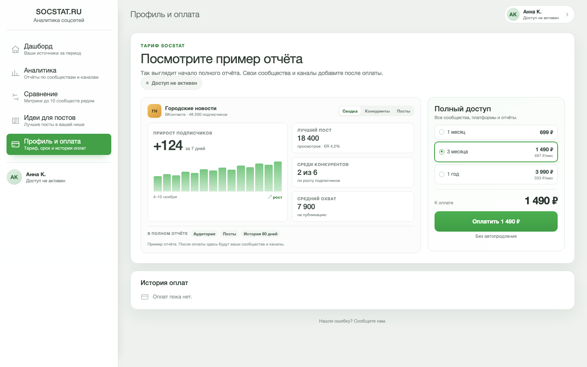
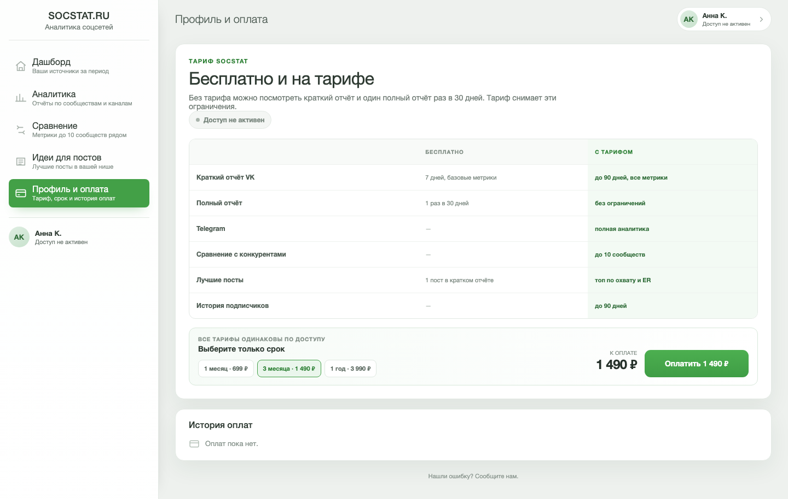
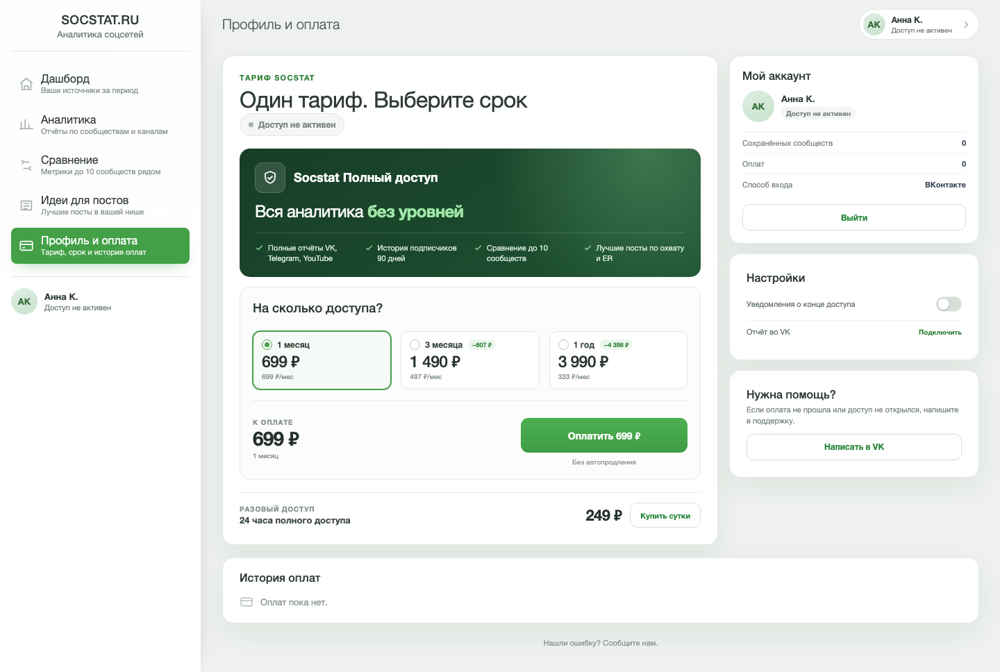

# Три идеи страницы прайсинга для новых клиентов

Контекст: пользователь ещё не платил, скидок нет. Задача страницы — не «показать три карточки», а объяснить, зачем платить и сколько это стоит.

Все макеты статичные. Цифры и сообщество «Городские новости» — демонстрационные. Продакшен-код не менялся.

## Идея A. Сначала пример отчёта

Смысл: показать продукт, а не описывать его. Слева — начало настоящего отчёта: прирост подписчиков, лучший пост, место среди конкурентов. Справа — цена и срок.

- Для кого: холодный трафик, который сомневается, что внутри.
- Сильная сторона: снимает риск «куплю и не пойму».
- Слабая сторона: нужен качественный пример и данные; на мобильном отчёт занимает много места.

HTML: [idea-proof.html](idea-proof.html)

## Идея B. Бесплатно и на тарифе

Смысл: честно показать разницу между бесплатным доступом и тарифом. Краткий отчёт, один полный отчёт в 30 дней, Telegram, конкуренты, лучшие посты, история — всё в одной таблице. Ниже — цена и срок.

- Для кого: новый клиент, который уже попробовал бесплатно и упёрся в ограничения.
- Сильная сторона: не надо верить на слово — видно, за что платишь и что остаётся бесплатным.
- Слабая сторона: таблица суховата; если человек пришёл «просто посмотреть цены», она может показаться длинной.

HTML: [idea-compare.html](idea-compare.html)

## Идея C. Один тариф, выберите срок

Смысл: убрать ложный выбор между «тарифами». Доступ один и тот же, отличаются только срок и цена за месяц. Сверху — что входит, ниже — обычный выбор из трёх сроков, справа — «Мой аккаунт», как на текущей странице.

- Для кого: тёплый трафик, который уже знает продукт и выбирает, на сколько купить.
- Сильная сторона: снимает вопрос «чем 3 месяца отличаются от года, кроме цены» и уменьшает выбор.
- Слабая сторона: меньше убеждения для холодного клиента; сначала нужно объяснить, зачем ему Socstat.

HTML: [idea-one-v4.html](idea-one-v4.html)

Что поправили после замечаний:

- убрали строку «1 тариф / 3 срока / 0 доплат»;
- убрали шкалу-шаги: срок — это дискретный выбор, а не прогресс. Вместо неё три обычные radio-карточки с полной ценой и ценой за месяц;
- месяц выбран по умолчанию, 3 месяца и год показывают разницу с месячной оплатой;
- собрали в одну колонку: пас-карта сверху, выбор срока снизу, без пустот между колонками;
- вернули правую колонку «Мой аккаунт» с настройками и поддержкой, как на текущем `/account`. На телефоне она уходит под блок оплаты;
- уменьшили высоту карточек срока: убрали нижнюю строку с экономией;
- сумму выгоды перенесли в верхнюю строку карточки рядом со сроком — компактным чипом «−607 ₽», без отдельной плашки на границе.

Ранние варианты: [idea-one.html](idea-one.html), [idea-one-v2.html](idea-one-v2.html), [idea-one-v3.html](idea-one-v3.html).

## Что общего

- Нет скидок и перечёркнутых цен.
- Пользователь без активного доступа, а не продлевающий.
- Везде есть срок, полная сумма и цена в месяц для 3 и 12 месяцев.
- Кнопка показывает фактическую сумму.
- На телефоне всё перестраивается в одну колонку: [A](screens/new-proof-mobile.png), [B](screens/new-compare-mobile.png), [C](screens/new-one-v4-mobile.png).

## Что я бы выбрал

Для нового клиента — **B**: она отвечает на главный вопрос «за что я плачу и что будет без тарифа», опирается на реальные ограничения бесплатного доступа и не обещает лишнего.

Если трафик уже тёплый и человек пришёл с рекламы про конкретную функцию — **C** короче и быстрее ведёт к оплате.

**A** сильнее всего продаёт продукт, но требует хорошего примера отчёта и много места на телефоне. Её можно использовать как первый экран, а B или C — как блок выбора срока ниже.

## Дневной тариф

Да, он есть: 24 часа полного доступа за 249 ₽, фича `dayPlan`, сейчас режим `all`. По выгрузке от 11 ноября 2026 в группе `offer` 3 показа и пока 0 полных 30-дневных окон. Право на сутки есть у новых пользователей без активного или пробного доступа и без старых цен; в контрольной группе эксперимента блока нет.

В макете сутки показаны отдельной строкой «Разовый доступ» под выбором срока, а не четвёртой карточкой:

- это разовая покупка, а не срок подписки;
- блок условный: в контрольной группе его не будет;
- текущая страница показывает сутки четвёртой карточкой наравне с месяцами. Если эксперимент продолжается, отдельная строка может занизить спрос и исказить результат. Тогда лучше вернуть сутки четвёртой карточкой или сделать переключатель «Подписка / 24 часа».
